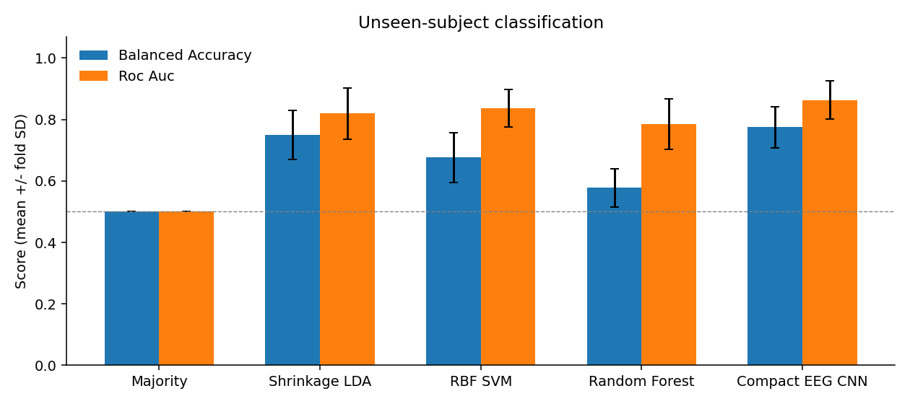

# Single-trial EEG oddball classification

Miniproject theo trang **139–145** của `neuroimaging_EEG_20261006.pdf`.
Nghiên cứu trên **dữ liệu EEG thật**, tập con 8 người của Nencki–Symfonia / OpenNeuro ds004621.

**Hai class:** `0 = Standard/Frequent (S5)`, `1 = Target (S6)`. Không dùng distractor S7.

| Thành viên | MSSV |
|---|---|
| Lê Minh Đức | 24022291 |
| Nguyễn Đức Trung | 24022473 |
| Phạm Sỹ Toàn | 24022467 |
| Đỗ Hoàng Minh | 24022399 |
| Đào Văn Việt | 24022489 |

## Bắt đầu sau khi clone

Repo có sẵn **`data/epochs.npz` (~40 MiB)**, chứa 4.543 trial EEG đã xử lý.
Bạn có thể huấn luyện lại mà không tải 5,6 GB dữ liệu gốc. Dùng Git để clone; không tải riêng file NPZ bằng trình duyệt.

```powershell
git clone https://github.com/trungnd06/TTKHTKUD_26-27.git
cd TTKHTKUD_26-27
python -m venv .venv
.\.venv\Scripts\python.exe -m pip install -r requirements.txt
.\.venv\Scripts\python.exe run_pipeline.py --mode verify
```

Trên Windows, các lệnh trên không cần kích hoạt venv,
tránh lỗi ExecutionPolicy. Nếu máy dùng Python Launcher, có thể thay lệnh tạo venv bằng `py -3.13 -m venv .venv`.
Khuyến nghị Python **3.13** để gần môi trường gốc (3.13.5). `requirements.txt` dùng constraints từ
`requirements-locked.txt` để giữ các phiên bản thư viện chính đã dùng; dependencies gián tiếp không khóa hoàn toàn.
Khác phiên bản Python/hệ điều hành vẫn có thể làm điểm thay đổi nhẹ.

Trên Linux/macOS, tạo môi trường bằng `python3 -m venv .venv`, rồi dùng
`.venv/bin/python` thay cho `.\.venv\Scripts\python.exe` trong các lệnh sau.

### Huấn luyện lại từ dữ liệu đã xử lý

```powershell
.\.venv\Scripts\python.exe run_pipeline.py --mode train
```

Lệnh này kiểm tra dữ liệu, chạy đủ mô hình, rồi kiểm tra kết quả. Nó cập nhật `results/` và các checkpoint,
nhưng không tự ghi đè báo cáo hoặc phân công thành viên. Xem thay đổi bằng `git diff` trước khi commit.
Thời gian tùy CPU; không cần GPU. Dùng `python experiment.py --output results_my_run` nếu muốn giữ nguyên kết quả gốc;
`verify_results.py` hiện kiểm tra thư mục mặc định `results/`.

### Đọc báo cáo và kết quả đã có

- [Báo cáo PDF](deliverables/Report_EN.pdf) · [Word](deliverables/Report_EN.docx) · [Markdown](deliverables/Report_EN.md)
- [PowerPoint](deliverables/Presentation_EN.pptx) · [Kịch bản tiếng Anh](deliverables/Presentation_script_EN.md)
- [Hướng dẫn và câu hỏi vấn đáp tiếng Việt](deliverables/HUONG_DAN_VA_VAN_DAP_VI.md)
- [Nguồn và cấu trúc dữ liệu](data/README.md) · [Cộng tác GitHub](docs/GITHUB_SETUP.md)

| Mô hình | ROC-AUC (mean ± SD) | Balanced accuracy (mean ± SD) |
|---|---|---|
| Majority | 0.500 ± 0.000 | 0.500 ± 0.000 |
| Shrinkage LDA | 0.820 ± 0.083 | 0.750 ± 0.079 |
| RBF SVM | 0.836 ± 0.062 | 0.676 ± 0.081 |
| Random Forest | 0.785 ± 0.082 | 0.578 ± 0.063 |
| Compact EEG CNN | **0.863 ± 0.062** | **0.775 ± 0.067** |

Đây là kết quả pilot 8 người, 4 fold theo người và một base seed; SD không phải khoảng tin cậy.
CNN có AUC cao hơn trong lần chạy này, chưa đủ để kết luận luôn tốt hơn ML.



## Chạy lại từ bản ghi gốc

Chạy lệnh từ thư mục này, với Python 3.10 trở lên:

```powershell
python -m pip install -r requirements.txt
python download_data.py
python preprocess.py
python experiment.py
python verify_results.py
python build_deliverables.py
```

Hoặc dùng `python run_pipeline.py --mode full` để tải, tiền xử lý, huấn luyện và kiểm tra.
Muốn tạo lại tài liệu, chạy riêng `python build_deliverables.py` sau khi kiểm tra kết quả.
**Lưu ý:** script tạo tài liệu hiện tạo lại các file báo cáo/slide và `contributions.csv` theo phân công đề xuất;
sao lưu các chỉnh sửa thủ công của nhóm trước khi chạy script này.

Phiên làm việc hiện tại cài thêm thư viện trong `.vendor/`; `bootstrap.py` tự nhận thư mục này.
Lần tải đầu cần Internet và khoảng 5.5 GB cho 8 bản ghi oddball. File đã có đúng dung lượng sẽ được dùng lại.
Máy cần khoảng 3 GB RAM trống; huấn luyện dùng CPU, hai luồng PyTorch. Không cần tài khoản hoặc API key.
`download_data.py` chỉ ghi các file dự án và không gửi email.

`Miniproject_EEG_Group.zip` chứa mã, tài liệu, kết quả và `data/epochs.npz` đã tiền xử lý,
không chứa thư viện cục bộ hoặc 5.6 GB bản ghi gốc. Sau khi giải nén và cài thư viện,
có thể chạy ngay `python experiment.py` rồi `python verify_results.py` để kiểm tra lại mô hình.
Dùng `requirements-locked.txt` nếu cần các phiên bản trực tiếp của lần chạy đã bàn giao.
Chạy `python package_project.py` để đóng gói lại sau khi nhóm sửa tài liệu.

## Tài liệu bàn giao

- `deliverables/Report_EN.docx`, `Report_EN.pdf`, `Report_EN.md`: báo cáo tiếng Anh có kết quả thật.
- `deliverables/Presentation_EN.pptx`: slide tiếng Anh và speaker notes.
- `deliverables/Presentation_script_EN.md`: kịch bản 9 phút.
- `deliverables/HUONG_DAN_VA_VAN_DAP_VI.md`: hướng dẫn và câu hỏi bảo vệ bằng tiếng Việt.
- `deliverables/contributions.csv`: phân công và tỷ lệ **đề xuất**, cần từng thành viên xác nhận theo việc thực tế.
- `results/`: bảng điểm từng fold, dự đoán từng trial, biểu đồ, giải thích CNN và kiểm tra tính đúng.
- `data/download_manifest.json`: URL, kích thước, ETag và SHA-256 của dữ liệu đã tải.
- `data/preprocessing_audit.json`: số lượt trước/sau loại nhiễu của từng người.

## Thiết kế đánh giá

Chỉ dùng oddball: **S5 = standard/frequent (0), S6 = target (1)**; loại S7 và marker phản hồi.
16 điện cực xác định trước; tham chiếu trung bình 16 kênh, lọc 0.5–30 Hz, epoch −0.2 đến 1 s,
baseline −0.2 đến 0 s, loại peak-to-peak >150 µV hoặc phẳng <0.1 µV, lấy mẫu lại 128 Hz.
Không tự động chạy ICA vì không có bước kiểm duyệt component; nhiễu còn sót là giới hạn nghiên cứu.

4 outer folds theo người, mỗi fold test 2 người. Hai người khác làm validation, 4 người còn lại train.
Scaler chỉ fit train. Validation chọn SVM C, độ sâu RF và epoch CNN; không chọn theo test.
Mọi mô hình dùng cùng trial và fold. Báo cáo mean ± SD theo fold; SD không phải khoảng tin cậy.
ROC-AUC là tiêu chí chọn cấu hình; balanced accuracy phản ánh mất cân bằng lớp.
Ngưỡng phân loại cố định 0.5, không điều chỉnh theo test. SVM có calibration nội bộ trên train.

## Mở rộng

```powershell
python download_data.py --subjects 1 3 4 5 6 7 8 9 10 11 12 13
python preprocess.py
python experiment.py --epochs 60 --output results_extended
```

`preprocess.py` dùng tất cả subject oddball đã tải. Kết quả mở rộng sẽ khác bản pilot.
`build_deliverables.py` và `verify_results.py` mặc định đọc `results/`.
Muốn chạy cả 42 người, truyền danh sách 1–42; cần dung lượng và thời gian lớn hơn.
Tập pilot bỏ sub-02 do vấn đề hiểu hướng dẫn được bài gốc nêu; sub-14, sub-17 cũng không trong tập chọn.
Đây là tập thuận tiện phục vụ miniproject, không đại diện đầy đủ 42 người.

## Yêu cầu trước khi nộp

1. Nhóm kiểm tra báo cáo, chạy lại mã và xác nhận tỷ lệ đóng góp thực tế (tổng 100%).
2. Điền ngày thuyết trình khi có lịch, tên lớp/giảng viên nếu trường yêu cầu.
3. Gửi báo cáo ít nhất một tuần trước buổi thuyết trình đến `guy.nagels@vub.be`, thầy Trần Quốc Sang và thầy Nguyễn Tiến Dũng theo slide. Địa chỉ hai thầy chưa có trong slide.
4. Thuyết trình tiếng Anh tối đa 10 phút; mọi thành viên có mặt và đều chuẩn bị trả lời câu hỏi.

Nguồn: [bài gốc](https://doi.org/10.1093/gigascience/giac015),
[GigaDB](https://doi.org/10.5524/100990),
[OpenNeuro dataset repository](https://github.com/OpenNeuroDatasets/ds004621),
[EEGNet](https://arxiv.org/abs/1611.08024),
[Integrated Gradients](https://arxiv.org/abs/1703.01365).

## File nào được đưa lên GitHub?

Mã Python, README, dependencies, dữ liệu đã xử lý, metadata nguồn, kết quả, checkpoint CNN,
báo cáo và PowerPoint đều được theo dõi bằng Git. Không cần Git LFS cho file hiện tại.
`.gitignore` bỏ qua dữ liệu gốc 5,6 GB, thư viện cục bộ, virtualenv, cache, file ZIP và ảnh preview.
File slide môn học không nằm trong repo; yêu cầu liên quan đã được tóm tắt ở trên và trong báo cáo.

`data/dataset_description.json` lưu giấy phép **CC0 của dữ liệu gốc**, tác giả và DOI do bên phát hành cung cấp.
Giấy phép dữ liệu không tự động là giấy phép của toàn bộ mã và tài liệu nhóm.
