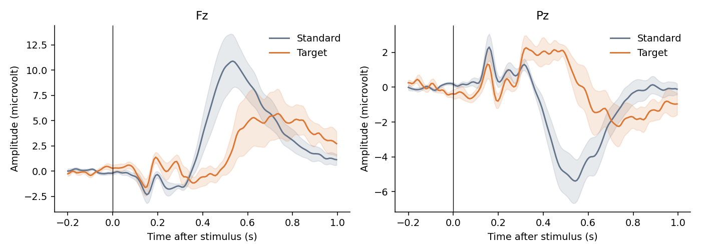
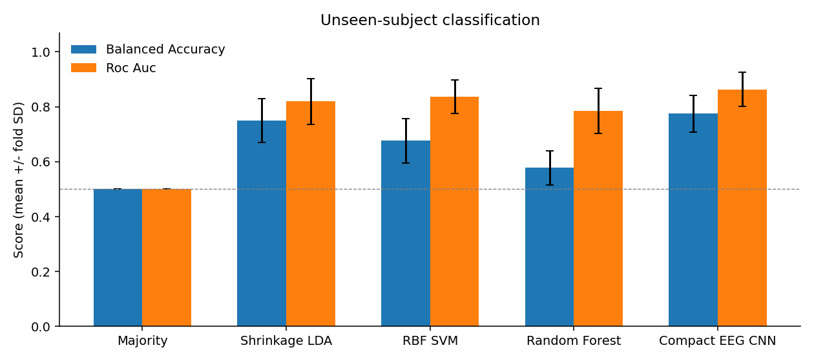
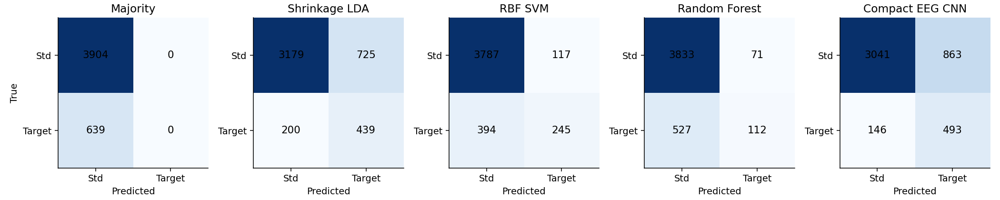
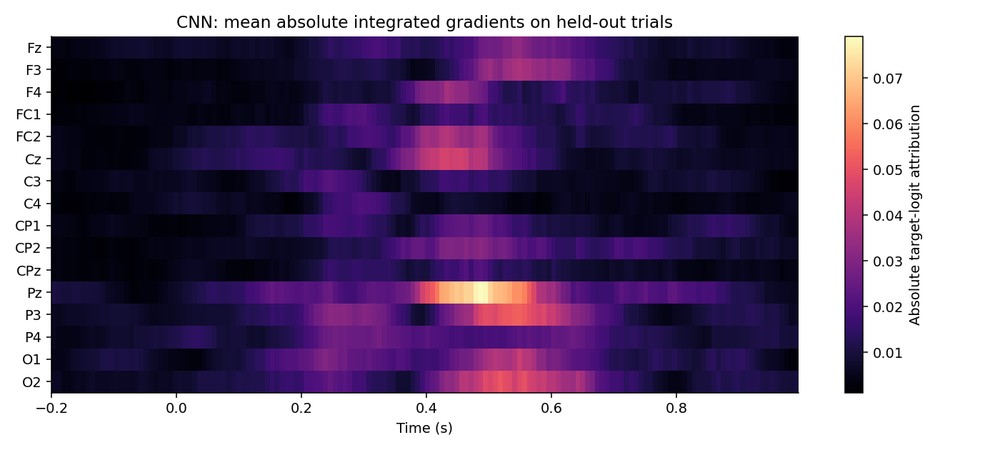
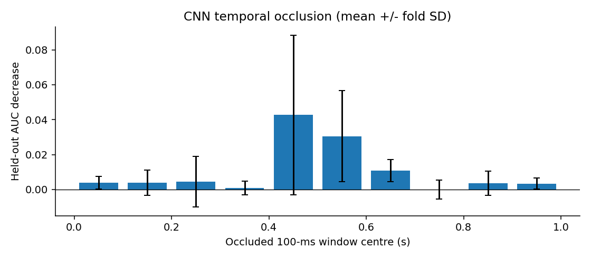

# Single-Trial EEG Classification of Frequent and Target Stimuli

Nencki-Symfonia dataset | A reproducible eight-subject pilot

- Lê Minh Đức — 24022291
- Nguyễn Đức Trung — 24022473
- Phạm Sỹ Toàn — 24022467
- Đỗ Hoàng Minh — 24022399
- Đào Văn Việt — 24022489

## Abstract

We implemented a reproducible pilot for single-trial classification of frequent versus target EEG stimuli. The experiment used 4,543 retained trials from eight participants in the Nencki-Symfonia oddball dataset. We compared shrinkage LDA, RBF SVM, Random Forest and a compact EEG CNN using four subject-disjoint outer folds. The highest mean test ROC-AUC was 0.863 (Compact EEG CNN); its balanced accuracy was 0.775. The CNN had the higher mean held-out AUC in this pilot. Integrated gradients and temporal occlusion supplied model explanations. These results concern a small, selected sample and one training seed; they do not establish a universal best classifier.

## 1. Questions and scope

RQ1: Which tested model gives the best single-trial frequent-versus-target discrimination on unseen subjects? We define best primarily by mean outer-fold ROC-AUC, while reporting balanced accuracy and target-class F1 as complementary measures.

RQ2: Does a deep model outperform conventional ML under the same trial and subject splits? RQ3: Which times and sensors influence the CNN, and are those patterns compatible with ERP physiology?

A trial is the multichannel EEG response to one stimulus. ERP grand averages are used only for visualization. The classifiers receive individual trials; averaging trials before classification would answer a different question.

## 2. Dataset and provenance

The course points to the Nencki-Symfonia dataset [1,2]. We downloaded its public OpenNeuro copy ds004621 [3]. The original study contains 42 adults and multiple tasks; this project uses only oddball. The task includes frequent standard stimuli, rare targets and rare distractors. We map S5 to standard (0), S6 to target (1), and omit S7 distractors and response markers.

Our pilot subjects are sub-01, sub-03, sub-04, sub-05, sub-06, sub-07, sub-08, sub-09. They were selected for a manageable local experiment. Sub-02 was skipped because the source paper reports a task-compliance problem; sub-14 and sub-17, also flagged there, are outside the pilot. This is a convenience subset, not a representative or randomly sampled cohort. No subject was excluded after inspecting classification performance.

There were 4,632 eligible standard/target events before rejection. We retained 3,904 standards and 639 targets; 89 events were dropped (1.9%). Each downloaded file has its source URL, byte count, ETag and SHA-256 in the manifest. This pins the actual downloaded bytes even though the public S3 path is not an immutable snapshot.

## 3. Signal preprocessing

We used MNE-Python [6] to read BrainVision recordings. Sixteen sensors were fixed before evaluation: Fz, F3, F4, FC1, FC2, Cz, C3, C4, CP1, CP2, CPz, Pz, P3, P4, O1, O2. This set covers frontal, central, parietal and occipital sites while reducing memory and model size.

Continuous recordings were re-referenced to the average of these 16 sensors and filtered from 0.5 to 30 Hz with a fourth-order Butterworth IIR, using MNE forward-backward filtering. Epochs span -0.2 to 1.0 s relative to stimulus onset. Their pre-stimulus mean (-0.2 to 0 s) is subtracted. We reject an epoch if any retained channel has peak-to-peak amplitude above 150 microvolts or below 0.1 microvolts, then resample to 128 Hz. Distractors and button-response events never become classification examples.

These operations use fixed parameters and no class-fitted transforms. Each subject is processed independently. No ICA or manual component rejection was performed; residual ocular and muscle activity may remain. The selected-sensor reference differs from a full-cap average reference. A 30 Hz low-pass already attenuates 50 Hz line noise. Zero-phase filtering uses future samples, so this implementation is an offline analysis, not a validated online BCI.

## 4. Models and training

Classical features are 20 nonoverlapping 50 ms mean-amplitude windows between 0 and 1 s at each sensor, giving 320 features per trial. They preserve ERP timing and polarity. Standardization is fitted on training trials only for LDA and SVM. The majority classifier reports training class priors and predicts the frequent class at threshold 0.5.

Shrinkage LDA uses automatic covariance shrinkage with equal class priors. RBF SVM uses balanced class weights and chooses C from {0.1, 1, 10} by validation AUC; gamma uses scikit-learn scale. Its probability calibration is internal to training data. Random Forest uses 200 trees, minimum leaf size 3, balanced class weights, and validation chooses depth 6 or unlimited.

Our compact CNN is inspired by EEGNet depthwise/separable convolutions [4], but is not an exact reproduction. It receives the full baseline-corrected epoch, including the pre-stimulus interval. Eight 33-sample temporal filters precede 16 grouped spatial filters, batch normalization, ELU, average pooling and dropout 0.35. A depthwise 9-sample temporal convolution and pointwise convolution precede adaptive pooling to 8 time bins and a linear target logit.

CNN normalization uses each channel mean and standard deviation over training trials and time. Training uses AdamW (learning rate 0.001, weight decay 0.01), batch size 64, gradient clipping at norm 5, a maximum of 35 epochs, and patience 8 on validation AUC. Binary cross-entropy weights the target class by the training standard-to-target ratio. The best validation checkpoint is restored. The base random seed is 42; CNN fold seeds are base + fold.

## 5. Evaluation and safeguards

Four GroupKFold outer splits hold out two subjects each. In each outer development set, two other subjects form validation and the remaining four form training. Validation membership follows a fixed rotation of sorted development subject IDs, without using labels or performance. Exact memberships are recorded below and in results/splits.json. Every retained trial is tested exactly once per model.

Only validation AUC selects hyperparameters and CNN epochs. Test labels are used only for evaluation and post-training explanation. All models use identical trial splits. No oversampling, test normalization fitting or test threshold tuning is performed. The classification threshold is fixed at probability 0.5. CNN weighted-loss scores are not guaranteed to be calibrated probabilities.

ROC-AUC measures score ranking; balanced accuracy is the mean of target sensitivity and standard specificity. Average precision summarizes the precision-recall curve and is sensitive to prevalence. We report mean +/- sample SD across four folds. These folds share training subjects, so their SD is descriptive and is not a confidence interval. The best observed mean is a descriptive ranking among the tested methods; it is not an unbiased estimate after model-family selection.

## 6. Measured classification results

Compact EEG CNN had the highest mean held-out ROC-AUC (0.863 +/- 0.062). Its balanced accuracy was 0.775 +/- 0.067. The CNN AUC was 0.863; the strongest classical model by mean AUC was RBF SVM (0.836). The paired foldwise CNN-minus-ML differences were +0.014, +0.011, +0.056, +0.026.

The CNN had the higher mean held-out AUC in this pilot. The mean difference was +0.027 AUC. This is not evidence of universal superiority: the subset is small, budgets differ by model family, and there are no repeated training seeds or independent final cohort.

Target prevalence after rejection was 14.1%. The majority baseline mean accuracy was 0.859, despite balanced accuracy and ROC-AUC both being 0.500. This shows why raw accuracy alone is misleading. The pooled confusion matrices below use only out-of-fold predictions. ROC curves average within-fold curves rather than treating independently calibrated fold scores as one common scale.

| Model | Balanced accuracy | ROC-AUC | PR-AUC (AP) | Target F1 |

| --- | --- | --- | --- | --- |

| Majority | 0.500 ± 0.000 | 0.500 ± 0.000 | 0.141 ± 0.001 | 0.000 ± 0.000 |

| Shrinkage LDA | 0.750 ± 0.079 | 0.820 ± 0.083 | 0.511 ± 0.179 | 0.502 ± 0.135 |

| RBF SVM | 0.676 ± 0.081 | 0.836 ± 0.062 | 0.565 ± 0.125 | 0.473 ± 0.150 |

| Random Forest | 0.578 ± 0.063 | 0.785 ± 0.082 | 0.449 ± 0.146 | 0.255 ± 0.154 |

| Compact EEG CNN | 0.775 ± 0.067 | 0.863 ± 0.062 | 0.602 ± 0.133 | 0.514 ± 0.111 |

## 7. Explaining the deep model

Integrated gradients [5] integrate the gradient of the target logit along a straight path from the training channel-mean baseline to the trial. We use 24 midpoint integration steps and aggregate absolute attribution over equal numbers of standard and target held-out trials, at most 32 per class per fold. The heatmap averages these per-fold maps equally. Absolute values show sensitivity magnitude and discard direction; they should not be read as signed evidence for target.

The largest mean absolute integrated-gradient channel totals were at Pz, P3, O2. The greatest mean AUC decrease under temporal occlusion occurred at 0.4-0.5 s (decrease 0.043). These are measured model-sensitivity summaries; they do not identify a neural generator.

For temporal occlusion, each 100 ms post-stimulus window is replaced by the training channel mean in standardized space, and held-out ROC-AUC is recalculated. A positive decrease means that removing this window worsened ranking. A negative value means performance improved under that perturbation. Sudden window boundaries can create artificial input patterns.

In our Pz ERP plot, targets are more positive than standards around 0.3-0.6 s. The Pz attribution hotspot around 0.4-0.6 s and the 0.4-0.5 s occlusion maximum are compatible with a P300-related condition difference. Absolute amplitudes and polarity depend on our 16-sensor reference, which differs from the source study. Targets also require a motor response, so models may exploit response-related signals, visual differences, or residual artifacts. Scalp attribution is neither source localization nor causal proof of cognitive mechanisms. We do not claim fully explainable or purely P300-based decisions.

## 8. Limitations and next experiments

The main limits are eight convenience-selected participants, one base seed, one fixed validation split per outer fold, a limited hyperparameter search, 16 selected sensors and residual artifacts. The CNN sees a short pre-stimulus interval whereas classical ERP features start at onset; this is a documented input difference. Post-stimulus motor activity can confound the interpretation of attention-related classification.

Useful extensions are the remaining cohort, repeated subject-disjoint validation, multiple CNN seeds, a matched post-stimulus-only CNN, and a pre-stimulus-only negative control. Artifact sensitivity, pre-response-only windows and comparisons with distractors could separate alternative explanations. Such experiments are proposed future work and are not represented as completed results.

## 9. Answers to the course questions

RQ1: Within our tested models and pilot protocol, Compact EEG CNN has the highest mean unseen-subject ROC-AUC, 0.863. This is a pilot result, not a global optimum.

RQ2: The CNN had the higher mean held-out AUC in this pilot. CNN-minus-best-ML mean AUC = +0.027. The experiment supports a comparison under the stated protocol, not a general claim that one learning paradigm is always better.

RQ3: We can inspect sensor/time sensitivity using integrated gradients and occlusion, and compare it with ERP patterns. These explanations are partial and baseline-dependent; they do not prove which physiological source caused the prediction.

## 10. Reproducibility and verification

Run download_data.py, preprocess.py, experiment.py, verify_results.py and build_deliverables.py, in that order. All scripts run from the project directory. Models, split memberships, per-trial predictions, fold metrics, learning curves and attribution arrays are saved.

verify_results.py checks disjoint subjects, complete out-of-fold coverage, label consistency, metric reconstruction, the majority baseline, and numerical integrated-gradient completeness on actual held-out examples. Exact library versions and seeds are recorded in results/run_metadata.json. Different library or hardware versions may give slightly different numerical results.

Environment: Python 3.13.5, NumPy 2.1.3, SciPy 1.15.3, scikit-learn 1.6.1, PyTorch 2.12.0+cpu.

## 11. Group contributions and submission

The following is a proposed equal work allocation, not a verified statement of completed individual work. Each member must review and reproduce their part, record their actual changes and understanding, then confirm or revise the percentages before submission. Proposed percentages total 100%. Automation-assisted project preparation does not establish any individual contribution.

The English presentation is designed for nine minutes, leaving one minute below the ten-minute maximum. All five members must attend and prepare for individual questions. Send the English report at least one week before presentation to guy.nagels@vub.be, Mr Tran Quoc Sang, and Mr Nguyen Tien Dung, using the latter two recipients' addresses supplied by the course. Presentation date and course-specific cover details have not been supplied.

## References

[1] Dzianok P et al. (2022). The Nencki-Symfonia electroencephalography/event-related potential dataset. GigaScience 11:giac015. https://doi.org/10.1093/gigascience/giac015

[2] Dzianok P et al. Supporting data. GigaScience Database. https://doi.org/10.5524/100990

[3] OpenNeuro ds004621, public dataset and metadata. https://github.com/OpenNeuroDatasets/ds004621 ; exact downloaded objects and SHA-256 hashes are in data/download_manifest.json.

[4] Lawhern VJ et al. (2018). EEGNet: A Compact Convolutional Network for EEG-based Brain-Computer Interfaces. https://arxiv.org/abs/1611.08024

[5] Sundararajan M, Taly A, Yan Q (2017). Axiomatic Attribution for Deep Networks. https://arxiv.org/abs/1703.01365

[6] MNE-Python, Epochs documentation. https://mne.tools/stable/generated/mne.Epochs.html

[7] Course slides: neuroimaging_EEG_20261006.pdf, pp. 139-145, supplied with this project.