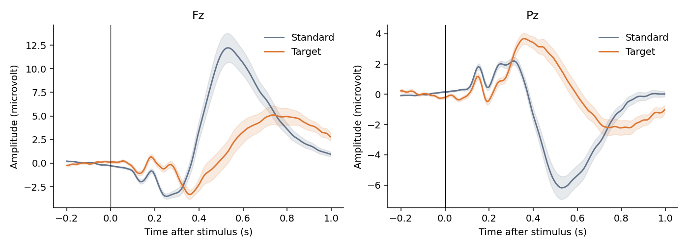
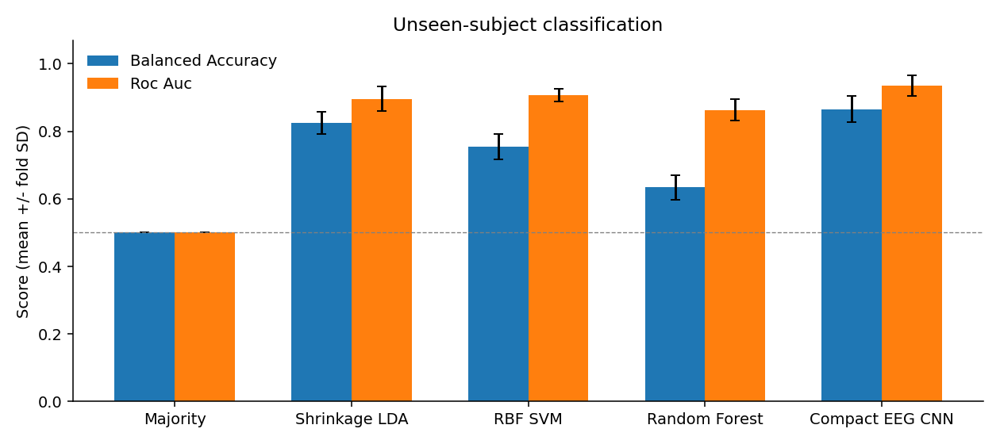
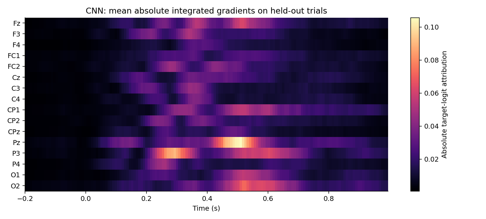
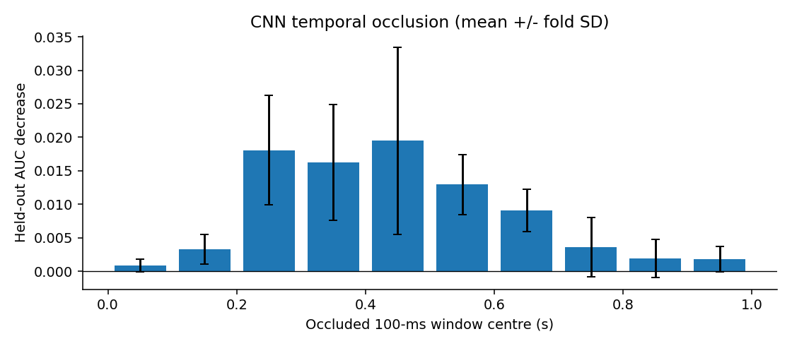

# Single-Trial EEG Classification of Frequent and Target Stimuli

Nencki-Symfonia | Full 42-participant oddball cohort

- Lê Minh Đức — 24022291

- Nguyễn Đức Trung — 24022473

- Phạm Sỹ Toàn — 24022467

- Đỗ Hoàng Minh — 24022399

- Đào Văn Việt — 24022489

## Abstract

We classify single EEG trials as frequent or target stimuli in the Nencki-Symfonia oddball task. The full available oddball cohort comprises 42 participants. After fixed signal-quality rejection, 24,200 trials remain: 20,801 standards and 3,399 targets. We compare shrinkage linear discriminant analysis, RBF support vector machines, Random Forest and a compact EEG convolutional network. Five subject-disjoint outer folds yield a CNN ROC-AUC of 0.936 ± 0.031 and balanced accuracy of 0.866 ± 0.039. The CNN exceeds RBF SVM by 0.029 mean ROC-AUC in this experiment. Integrated gradients and temporal occlusion indicate sensor/time reliance compatible with ERP condition differences. The findings are descriptive for one base seed and this evaluation protocol; artifact and motor-response confounds remain.

## 1. Research questions

The course questions [7] are: RQ1, which tested method gives the best single-trial frequent-versus-target classification? RQ2, does deep learning outperform standard machine learning under the chosen evaluation? RQ3, can the features used by the deep model be explained?

We define the primary ranking by mean outer-fold ROC-AUC and also report balanced accuracy, target F1 and raw accuracy. Every prediction is made from one trial. Grand-average ERP waveforms visualize condition differences; the classifiers do not receive averages across trials.

## 2. Dataset, scope and preprocessing

The dataset specified by the course is Nencki-Symfonia [1,2], retrieved from its public OpenNeuro copy ds004621 [3]. This experiment attempts all 42 oddball participants, sub-01 through sub-42, and retains all 42 after signal-quality criteria. S5 is standard/frequent (class 0), S6 is target (class 1). S7 distractors and response markers are not classification examples. REST, SRT and MSIT tasks are outside this binary classification question.

There are 24,440 standard/target events before rejection and 24,200 retained trials. 240 trials are dropped (0.98%). No participant is excluded by the preset rule of requiring at least 10 retained trials per class. Retention of all subjects does not imply artifact-free EEG or perfect behavioral compliance. Sub-02, sub-14 and sub-17, flagged for behavioral task-compliance issues in the source paper, remain included; this is a limitation of the all-subject analysis.

Preprocessing uses MNE-Python 1.13.2. Sixteen sensors are fixed in advance: Fz, F3, F4, FC1, FC2, Cz, C3, C4, CP1, CP2, CPz, Pz, P3, P4, O1, O2. Continuous data are referenced to the average of these sensors and filtered from 0.5 to 30 Hz with a fourth-order Butterworth IIR using forward-backward filtering. Epochs run from -0.2 to 1.0 s with baseline correction over -0.2 to 0 s. An epoch is rejected if any selected channel has peak-to-peak amplitude above 150 microvolts or below 0.1 microvolts. Retained epochs are resampled to 128 Hz, giving 154 time points and 16 channels per trial.

Interior acquisition boundaries are marked so filtering does not run across discontinuities and overlapping epochs are rejected. Affected recordings are sub-15, sub-23, sub-24, sub-37, sub-38. No ICA or manual component selection is performed. Residual ocular or muscle activity may remain; using only 16 sensors and fixed thresholds can miss artifacts. Forward-backward filtering uses future samples, so this is an offline analysis.

## 3. Features and models

Classical ML uses 20 successive 50 ms mean-amplitude windows from 0 to 1 s at each of 16 sensors, giving 320 features per trial. LDA and SVM use standardization fitted only on training trials. The majority baseline outputs training class priors.

Shrinkage LDA uses automatic covariance shrinkage and equal class priors. RBF SVM uses balanced class weights, gamma=scale, and validation selects C from {0.1, 1, 10}; probability calibration is internal to training data. Random Forest uses 200 trees, minimum leaf size 3 and balanced class weights; validation selects maximum depth 6 or unlimited.

The compact CNN is inspired by EEGNet [4] but is not an exact implementation. Eight temporal filters of length 33 precede 16 grouped spatial filters spanning all sensors, batch normalization, ELU, average pooling and dropout 0.35. A depthwise temporal convolution of length 9 and a pointwise convolution precede adaptive pooling to eight time bins and a linear target logit. The CNN receives the entire -0.2 to 1.0 s epoch, whereas classical features are post-stimulus; this input difference is a limitation.

Per-channel normalization is fitted on training trials and time samples only. CNN optimization uses AdamW with learning rate 0.001, weight decay 0.01, batch size 64 and gradient norm clipping at 5. Target-weighted binary cross-entropy uses the training standard/target ratio. Training allows 50 epochs and early-stopping patience 8 on validation AUC, then restores the best checkpoint. The selected epochs across five folds are 45, 14, 27, 39, 30.

## 4. Subject-disjoint evaluation

Five GroupKFold outer splits hold out 8 or 9 people for testing. Seven other people form validation, and 26 or 27 form training. Validation membership is selected by a fixed rotation of sorted development subject IDs, approximately 20% of development subjects. Every retained subject and trial appears in an outer test set exactly once for each model. Exact memberships are in splits.json.

Only validation AUC selects SVM C, forest depth and CNN checkpoint. Test labels are used after selection for evaluation and explanations. No test-fitted scaling, threshold tuning or oversampling is used. All methods share the same retained trials and splits. Classification uses a fixed threshold of 0.5. Class-weighted CNN sigmoid scores need not be calibrated probabilities.

ROC-AUC measures discrimination across thresholds. Balanced accuracy is the mean of target sensitivity and standard specificity. Average precision summarizes the precision-recall curve; F1 is reported for the target class. We report mean ± sample standard deviation across outer folds. The folds share some training subjects; SD is descriptive, not a confidence interval. Ranking model families on their observed test means does not provide an independent post-selection performance guarantee.

| Fold | Train subjects | Validation | Test |

| --- | --- | --- | --- |

| 1 | 27 | 7 | 8 |

| 2 | 27 | 7 | 8 |

| 3 | 26 | 7 | 9 |

| 4 | 27 | 7 | 8 |

| 5 | 26 | 7 | 9 |

## 5. Measured classification results

Compact EEG CNN achieves the largest mean ROC-AUC, 0.936 ± 0.031, and balanced accuracy, 0.866 ± 0.039. The strongest classical method by mean AUC is RBF SVM, 0.907 ± 0.020. CNN-minus-SVM AUC differences for the five paired outer folds are +0.050, +0.032, +0.010, +0.028, +0.021. All five favor the CNN in this run; this pattern alone is not a formal significance test or evidence of universal superiority.

Targets comprise 14.05% of retained trials. The majority classifier reaches 0.860 accuracy while AUC and balanced accuracy remain 0.500. SVM raw accuracy is 0.912, above CNN accuracy 0.887, but its target recall and balanced accuracy are lower. Different metrics therefore answer different questions. Accuracy alone should not determine the result for this imbalanced task.

CNN target precision is 0.577, recall 0.837, F1 0.679, and average precision 0.779. The comparison plot shows fold means and SD; confusion matrices aggregate only out-of-fold predictions. ROC curves average foldwise curves to avoid treating differently calibrated fold scores as one common scale.

| Model | ROC-AUC | Balanced accuracy | Target F1 | Accuracy |

| --- | --- | --- | --- | --- |

| Majority | 0.500 ± 0.000 | 0.500 ± 0.000 | 0.000 ± 0.000 | 0.860 ± 0.000 |

| Shrinkage LDA | 0.896 ± 0.036 | 0.825 ± 0.034 | 0.590 ± 0.042 | 0.844 ± 0.019 |

| RBF SVM | 0.907 ± 0.020 | 0.755 ± 0.037 | 0.630 ± 0.055 | 0.912 ± 0.008 |

| Random Forest | 0.863 ± 0.032 | 0.634 ± 0.036 | 0.409 ± 0.081 | 0.888 ± 0.007 |

| Compact EEG CNN | 0.936 ± 0.031 | 0.866 ± 0.039 | 0.679 ± 0.082 | 0.887 ± 0.034 |

## 6. Explaining the CNN

Integrated gradients [5] approximate the target-logit gradient integral from the training channel-mean baseline to each held-out trial. We use 24 midpoint integration steps. Each fold uses equal numbers of standard and target held-out trials, at most 32 per class. Absolute attribution is averaged over these trials and then across folds. It shows magnitude, not the direction of evidence for target.

The three largest mean absolute channel-attribution totals are Pz, P3, O2. The greatest mean occlusion AUC decrease is 0.019 in the 0.4-0.5 s window. These quantities describe model reliance, not a causal neural source.

The map shows prominent Pz sensitivity near 0.5 s and P3 sensitivity near 0.3 s. In the Pz ERP plot, targets are more positive than standards during the several-hundred-millisecond interval. These patterns are compatible with a P300-related condition difference, but reference choice affects voltage amplitude and polarity, and scalp attribution does not localize a neural generator.

Temporal occlusion replaces one 100 ms post-stimulus window by the training channel mean and recalculates held-out AUC. The greatest mean decrease is in 0.4-0.5 s (0.019 ± 0.014). The 0.2-0.3 s and 0.3-0.4 s windows also contribute. Abrupt masks can generate artificial inputs, so their effect is a sensitivity test.

Targets require a button response, unlike standards. Predictions may therefore exploit motor-related activity, visual differences or residual artifacts alongside attention-related ERPs. These explanations are partial and baseline-dependent, not causal proof of P300-based decisions.

## 7. Limitations and further work

This study includes the full 42-person oddball cohort, but remains limited to this dataset and one base seed. There are no repeated validation rotations, multiple CNN seeds, or independent external cohort. Hyperparameter search budgets differ by model family. The three participants with reported behavioral compliance issues remain included. Fixed amplitude rejection without ICA may leave artifacts.

Useful extensions are repeated seeds, subject-level uncertainty estimates, sensitivity analysis excluding sub-02/sub-14/sub-17, matched post-stimulus-only CNN inputs, a pre-stimulus-only negative control, and pre-response windows to investigate motor confounding. These are proposed analyses, not completed experiments. Earlier eight-subject pilot scores are not a controlled ablation because cohort, validation sizes and training budget changed.

## 8. Answers to the assignment

RQ1: The highest observed mean ROC-AUC among tested methods is 0.936, obtained by Compact EEG CNN, with balanced accuracy 0.866. This is not a global optimum over all possible methods.

RQ2: The CNN exceeds RBF SVM by 0.029 mean ROC-AUC in this experiment. The result favors the CNN under the stated protocol, while SVM has higher raw accuracy at threshold 0.5. We do not claim deep learning is always better.

RQ3: Integrated gradients and occlusion provide sensor/time explanations consistent with ERP differences. They do not isolate a causal physiological mechanism or exclude artifacts and motor-response information.

## 9. Reproducibility and verification

The full experiment is implemented in kaggle/01_prepare_full.ipynb and 02_train_full.ipynb. The preparation notebook downloads one subject at a time and saves processed data, trial audits, original file hashes and acquisition-boundary information. The training notebook saves configuration, data checksum, split IDs, predictions, learning curves, CNN checkpoints and per-fold resume caches.

The recorded training environment is Python 3.13.16, NumPy 2.1.3, SciPy 1.16.3, scikit-learn 1.6.1, PyTorch 2.11.0+cu130, with CNN CUDA execution on Tesla T4. The base seed is 42 and CNN fold seeds are base plus fold. Deterministic algorithms are requested with warn_only=True, so unsupported CUDA operations may remain nondeterministic. Hardware/software differences can change numerical results.

The Kaggle verifier passes subject separation, complete out-of-fold prediction coverage, metric reconstruction, majority baseline checks and integrated-gradients numerical completeness. Locally, all seven reported metrics were independently recomputed from 121,000 predictions, and all five checkpoint file hashes matched their fold caches. The preparation summary agrees with training trial counts, subject IDs and input-data hash. The full epochs file is retained on Kaggle; it was not supplied locally for a second direct hash calculation.

## 10. Group contributions and submission

The following equal allocation is a proposal, not a verified record of completed individual work. Each member must review their part, record actual work and demonstrated understanding, then confirm or revise the percentages before submission. The proposed total is 100%. Automated preparation and a name in the table do not establish individual contribution.

The English presentation has ten main slides with a planned nine-minute script and two backup slides. All members should attend and prepare for questions. Send the English report at least one week before presentation to guy.nagels@vub.be, Mr Tran Quoc Sang and Mr Nguyen Tien Dung, using the latter two addresses supplied by the course. The presentation date has not been supplied.

| Member / ID | Proposed responsibility | Proposed % |

| --- | --- | --- |

| Lê Minh Đức / 24022291 | Preprocessing and data quality | 20 |

| Nguyễn Đức Trung / 24022473 | ERP features and classical ML | 20 |

| Phạm Sỹ Toàn / 24022467 | CNN training and model comparison | 20 |

| Đỗ Hoàng Minh / 24022399 | Visualization and CNN explanations | 20 |

| Đào Văn Việt / 24022489 | Reproducibility, report and integration | 20 |

## Appendix A. Trial audit for all participants

Totals: 24,440 eligible standard/target events; 24,200 retained; 240 dropped. No participant failed the minimum per-class trial criterion. Behavioral compliance and signal quality are distinct.

| Subject | Standard before | Target before | Standard kept | Target kept | Dropped |

| --- | --- | --- | --- | --- | --- |

| sub-01 | 498 | 81 | 497 | 81 | 1 |

| sub-02 | 498 | 81 | 488 | 78 | 13 |

| sub-03 | 498 | 81 | 498 | 81 | 0 |

| sub-04 | 498 | 81 | 498 | 81 | 0 |

| sub-05 | 498 | 81 | 498 | 81 | 0 |

| sub-06 | 498 | 81 | 494 | 81 | 4 |

| sub-07 | 498 | 81 | 423 | 72 | 84 |

| sub-08 | 498 | 81 | 498 | 81 | 0 |

| sub-09 | 498 | 81 | 498 | 81 | 0 |

| sub-10 | 498 | 81 | 498 | 81 | 0 |

| sub-11 | 498 | 81 | 498 | 81 | 0 |

| sub-12 | 498 | 81 | 498 | 81 | 0 |

| sub-13 | 498 | 81 | 498 | 81 | 0 |

| sub-14 | 498 | 81 | 487 | 80 | 12 |

| sub-15 | 498 | 81 | 498 | 81 | 0 |

| sub-16 | 498 | 81 | 497 | 80 | 2 |

| sub-17 | 498 | 81 | 498 | 81 | 0 |

| sub-18 | 498 | 81 | 477 | 79 | 23 |

| sub-19 | 498 | 81 | 486 | 81 | 12 |

| sub-20 | 498 | 81 | 498 | 81 | 0 |

| sub-21 | 498 | 81 | 497 | 81 | 1 |

| sub-22 | 498 | 81 | 498 | 81 | 0 |

| sub-23 | 517 | 86 | 517 | 86 | 0 |

| sub-24 | 497 | 81 | 497 | 81 | 0 |

| sub-25 | 498 | 81 | 488 | 80 | 11 |

| sub-26 | 498 | 81 | 497 | 81 | 1 |

| sub-27 | 498 | 81 | 498 | 81 | 0 |

| sub-28 | 498 | 81 | 497 | 81 | 1 |

| sub-29 | 498 | 81 | 498 | 81 | 0 |

| sub-30 | 498 | 81 | 498 | 81 | 0 |

| sub-31 | 498 | 81 | 498 | 81 | 0 |

| sub-32 | 498 | 81 | 498 | 81 | 0 |

| sub-33 | 498 | 81 | 498 | 81 | 0 |

| sub-34 | 498 | 81 | 463 | 81 | 35 |

| sub-35 | 498 | 81 | 479 | 80 | 20 |

| sub-36 | 498 | 81 | 492 | 80 | 7 |

| sub-37 | 497 | 81 | 494 | 79 | 5 |

| sub-38 | 583 | 96 | 581 | 95 | 3 |

| sub-39 | 498 | 81 | 498 | 81 | 0 |

| sub-40 | 498 | 81 | 494 | 80 | 5 |

| sub-41 | 498 | 81 | 498 | 81 | 0 |

| sub-42 | 498 | 81 | 498 | 81 | 0 |

## References

[1] Dzianok P et al. (2022). The Nencki-Symfonia electroencephalography/event-related potential dataset. GigaScience 11:giac015. https://doi.org/10.1093/gigascience/giac015

[2] Dzianok P et al. Supporting data. GigaScience Database. https://doi.org/10.5524/100990

[3] OpenNeuro ds004621. https://github.com/OpenNeuroDatasets/ds004621 . Downloaded file URLs, ETags and SHA-256 values are recorded per subject in results_full/preparation_summary.json.

[4] Lawhern VJ et al. (2018). EEGNet: A Compact Convolutional Network for EEG-based Brain-Computer Interfaces. https://arxiv.org/abs/1611.08024

[5] Sundararajan M, Taly A, Yan Q (2017). Axiomatic Attribution for Deep Networks. https://arxiv.org/abs/1703.01365

[6] MNE-Python, Epochs documentation. https://mne.tools/stable/generated/mne.Epochs.html

[7] Course slides: neuroimaging_EEG_20261006.pdf, pp. 139-145, supplied with this project.